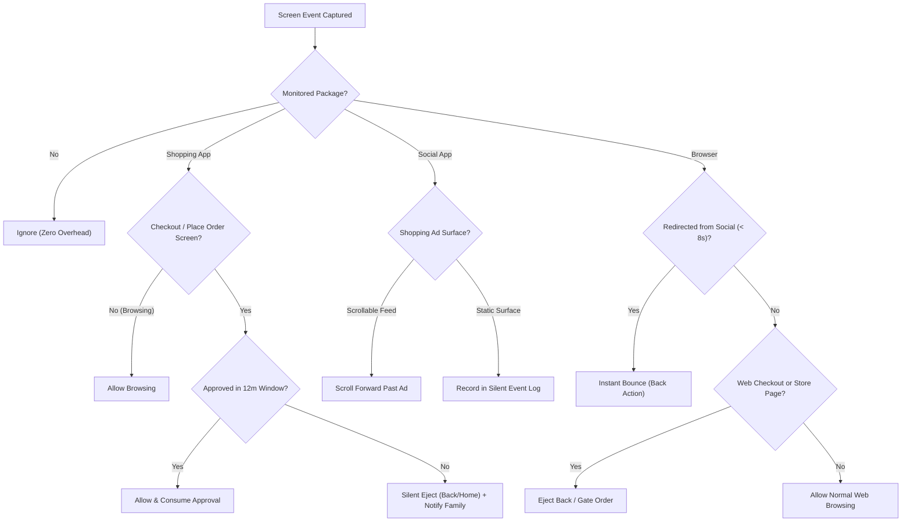

# Order Guardian (Ad & Shopping Guardian) 🛡️

[](https://kotlinlang.org)
[-green.svg?logo=android)](https://developer.android.com)
[](https://gradle.org)
[](LICENSE)

An intelligent, non-intrusive Android guardian system designed to protect elderly family members from impulse online purchases and deceptive social media shopping ads.

---

## 📌 Problem Statement

Many elderly individuals enjoy browsing YouTube Shorts, Instagram Reels, Facebook feeds, and shopping apps like Amazon or Flipkart. However:

1. **Deceptive & Aggressive Ads**: Modern social feeds are saturated with heavily targeted ads ("Shop Now", "Special Deal") promoting impulse buys, fake health remedies, or unneeded gadgets.
2. **One-Click Impulse Purchases**: Clicking an ad redirects directly to e-commerce stores (Shopify, WooCommerce, custom web shops) or shopping apps with Cash-on-Delivery (COD) or pre-saved cards enabled.
3. **Memory Gaps & Financial Strain**: Elderly users often place orders on impulse and forget doing so. Family members are left managing unwanted deliveries, cancellations, and delivery disputes.
4. **Intrusive Screen Blockers Don't Work**: Full-screen lockouts or loud warnings create panic, confusion, and frustration for the elderly person.
5. **Browser Redirect Loophole**: Blocking native shopping apps alone is insufficient. Social ads frequently launch external browsers (Chrome, Samsung Internet, DuckDuckGo) where checkout forms can still be submitted or reloaded from background apps.

---

## 💡 The Solution: Order Guardian

**Order Guardian** is a dual-app architecture that acts as a quiet, protective safety net:

- **Silent Action**: No alarming popups, loud sirens, or confusing UI overlays. Ejections happen seamlessly using system actions (`Back` or `Home`).
- **Comprehensive Multi-Layer Defense**:
  1. **Shopping App Checkout Gate**: Protects native apps (Amazon India, Flipkart). Allows free browsing of product catalogs, reviews, and search results; triggers only when reaching the address/payment/place-order screen.
  2. **Social Media Ad Skipping**: Recognizes ad surfaces (`Sponsored`, `Advertisement`, `Ad`, `विज्ञापन`) paired with shopping CTAs (`Shop Now`, `Order Now`, `अभी खरीदें`) in YouTube, Instagram, Facebook, and WhatsApp, smoothly scrolling past them where possible.
  3. **Instant Social Browser Bounce**: If an ad click triggers an external browser (e.g. YouTube $\rightarrow$ Chrome), the guardian instantly bounces back before the store page can load or prompt the user.
  4. **Continuous Web Checkout Gate**: If an ad tab is re-opened later from Recent/Background apps, web checkout forms (Shopify, WooCommerce, payment gateways) are intercepted immediately.
  5. **Family Approval Workflow**: Ejected purchases generate a pending request for the family guardian. Approving the purchase unlocks a **single-use 12-minute window** strictly for that exact product, app, and price.

---

## 🏗️ Architecture & Modules

The repository is organized into three clean Gradle modules:

```
┌─────────────────────────────────────────────────────────────┐
│                       :shared                               │
│  Pure Kotlin / JVM library (Zero Android dependencies)      │
│  - CheckoutRules (2+ signal multi-language detector)        │
│  - AdRules (Social ad detection & scroll logic)             │
│  - CheckoutGate (State machine, allow-once, deduplication)  │
│  - CheckoutFingerprint (SHA-256 app + product + price hash) │
│  - EjectLogic (Escalation from Back to Home)                │
└──────────────┬──────────────────────────────┬───────────────┘
               │                              │
               ▼                              ▼
┌───────────────────────────────┐  ┌──────────────────────────┐
│          :guardian            │  │        :approver         │
│  Elderly User Phone App       │  │  Family Member Phone App │
│  - AccessibilityService       │  │  - Real-time approval UI │
│  - Battery optimization tools │  │  - Firestore sync        │
│  - Local & Firestore repos    │  │  - Push notifications    │
│  - Silent background logger   │  │  - Single-tap decision   │
└───────────────────────────────┘  └──────────────────────────┘
```

### Module Breakdown

| Module | Namespace | Role |
|---|---|---|
| **`:shared`** | `com.rockstar.orderguardian.shared` | Cross-platform rules engine. Fully unit-tested on JVM without emulator. Evaluates screens based on keywords, totals, and package contexts. |
| **`:guardian`** | `com.rockstar.orderguardian` | Runs on the protected phone. Employs a low-overhead `AccessibilityService` scoped strictly to target packages with throttled window scans (250ms, $\le$ 500 nodes). |
| **`:approver`** | `com.rockstar.orderguardian.approver` | Runs on the family member's phone. Displays pending orders with full product context, price, and a countdown timer. |

---

## 🛡️ Multi-Layer Defense Mechanism



---

## 🔋 Battery & Performance Optimization

Accessibility services often suffer from battery drain if unconstrained. Order Guardian is engineered specifically to prevent this:

- **Strict Package Filtering**: The OS never wakes the service for camera, calls, system settings, or unmonitored apps.
- **Throttled Traversal**: Events are rate-limited to at most one scan per 250ms.
- **Node Capping**: Traversal stops at 500 nodes, preventing lockups on infinite feeds.
- **Zero Polling & Wakelocks**: No background CPU threads or GPS wakeups when the screen is turned off.
- **Real-World Impact**: Consumes under **1% – 1.5%** of battery per 24 hours.

---

## 📱 Monitored Applications & Browsers

- **Shopping Apps**: Amazon (`com.amazon.mShop.android.shopping`, `in.amazon.mShop.android.shopping`), Flipkart (`com.flipkart.android`).
- **Social Media**: YouTube (`com.google.android.youtube`), Instagram (`com.instagram.android`), Facebook & FB Lite (`com.facebook.katana`, `com.facebook.lite`), WhatsApp (`com.whatsapp`).
- **Browsers**: Google Chrome, Samsung Internet, Mozilla Firefox, Microsoft Edge, Opera, Brave, DuckDuckGo, Vivo Browser, Oppo HeyTap Browser, Xiaomi Mi Browser.

---

## 🚀 How to Build & Run

### Prerequisites
- **JDK 17** (e.g. Amazon Corretto, OpenJDK)
- **Android SDK** (API Platform 34, Build Tools 34.0.0+)
- **Android Gradle Plugin (AGP) 8.5.2** / **Gradle 8.7**

### 1. Clone the Repository
```bash
git clone https://github.com/MetriSomesh/Add-Guardian.git
cd Add-Guardian
```

### 2. Configure SDK Path
Create a `local.properties` file in the root directory:
```properties
sdk.dir=/path/to/your/Android/Sdk
```

### 3. Run Unit Tests
```bash
./gradlew :shared:test
```

### 4. Build APKs
```bash
# Build Guardian app (Protected phone)
./gradlew :guardian:assembleRelease

# Build Approver app (Family phone)
./gradlew :approver:assembleRelease
```
The output APKs will be located at:
- `guardian/build/outputs/apk/release/`
- `approver/build/outputs/apk/release/`

---

## 📲 Device Setup Guide

### Setting up the Guardian Phone
1. Install `guardian.apk` on the elder's phone (`adb install guardian.apk` or via file transfer).
2. **Allow Restricted Settings** (Android 13+):
   - Go to **Settings $\rightarrow$ Apps $\rightarrow$ Order Guardian $\rightarrow$ ⋮ (top right) $\rightarrow$ Allow restricted settings**.
3. **Enable Accessibility Service**:
   - Go to **Settings $\rightarrow$ Accessibility $\rightarrow$ Installed apps $\rightarrow$ Order Guardian Protection $\rightarrow$ Turn ON**.
4. **Battery Optimization**:
   - Set Battery usage to **Unrestricted** for Order Guardian so Android doesn't kill the background listener.

### Setting up the Approver Phone
1. Install `approver.apk` on the family member's phone.
2. Grant notification permissions to receive instant purchase approval requests.
3. Configure Firebase following the guide in [`SETUP_FIREBASE.md`](SETUP_FIREBASE.md) for live cross-device sync.

---

## 🔒 Privacy & Safety First

- **Zero Payment Data Access**: The accessibility scraper only extracts visible product text labels and prices for fingerprinting. Card details, UPI PINs, bank accounts, and passwords are never read or stored.
- **Local-First Test Mode**: Runs out-of-the-box in standalone on-device mode without sending data over the network until Firebase credentials are provided.
- **Fail-Closed Security**: In the absence of network or family approval, the system defaults to preventing the checkout.

---

## 📄 License

This project is open-source and available under the [MIT License](LICENSE).
